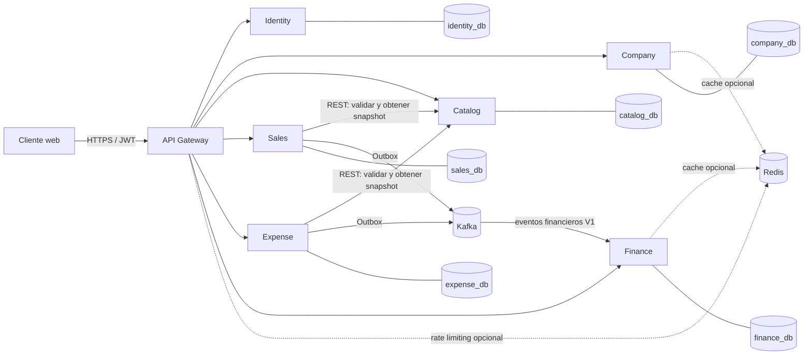
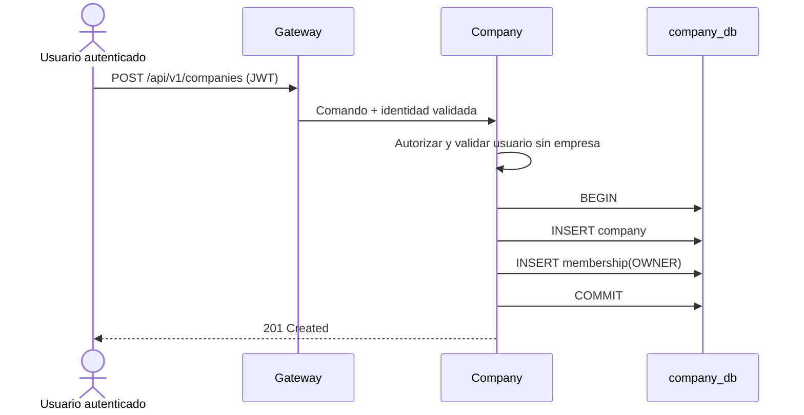
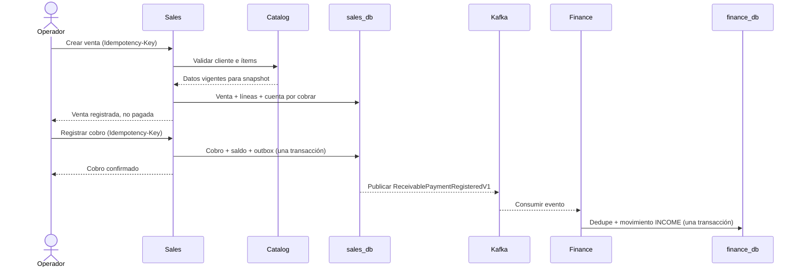
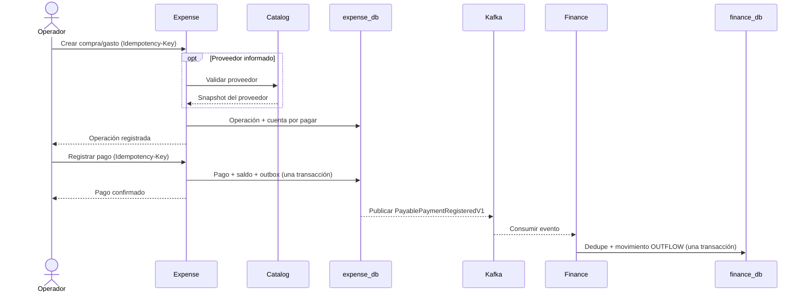

# ADR-001: Propiedad de datos y comunicación entre servicios

- **Estado:** Aceptado
- **Fecha:** 2026-11-14
- **Ticket:** [S2-303](https://devjoanvasquez-1791077375328.atlassian.net/browse/S2-303)
- **Decisores:** equipo SaniGest
- **Ámbito:** backend de SaniGest
- **Documento relacionado:** `SaniGest_T1001_Contrato_Funcional_v0.7.md`

## 1. Contexto

SaniGest se implementará como un conjunto de microservicios con límites de datos
estrictos. Un servicio no puede consultar las tablas de otro ni compartir sus
entidades o repositorios JPA. Las dependencias remotas también deben aislarse
para evitar que una indisponibilidad produzca una caída en cascada.

Este ADR define:

- la fuente de verdad y las tablas que pertenecen a cada servicio;
- las dependencias permitidas y prohibidas;
- cuándo usar REST síncrono o eventos Kafka;
- los flujos empresa–propietario, venta–cobro–ingreso y
  gasto–pago–egreso;
- timeouts, reintentos, circuit breakers y comportamiento ante fallos;
- las decisiones de despliegue para AWS, Docker y Kubernetes.

Este documento es vinculante para nuevas historias. Una excepción requiere un
nuevo ADR que reemplace total o parcialmente esta decisión.

## 2. Decisión

Cada microservicio es dueño exclusivo de su modelo de dominio y de su almacén
PostgreSQL. Los servicios se integran mediante contratos REST versionados o
eventos Kafka versionados. Nunca se integran mediante tablas, vistas,
repositorios JPA o entidades compartidas.

La arquitectura usa:

- Java y Maven;
- Spring Boot, Spring Data JPA, Bean Validation y Spring Security;
- Spring Cloud Gateway y clientes HTTP declarativos;
- Resilience4j para time limiter, circuit breaker y retry selectivo;
- Apache Kafka para integración asíncrona;
- Redis para cache distribuida de datos reconstruibles y de corta duración;
- PostgreSQL y Flyway por servicio;
- JUnit y Testcontainers para pruebas;
- GitHub Actions para integración, validación y entrega continua;
- Actuator y Micrometer para salud, métricas y observabilidad;
- Docker y Docker Compose para desarrollo e integración local;
- Kubernetes con `kind` para validación local y portabilidad;
- AWS ECR, ECS/Fargate y RDS PostgreSQL como despliegue del MVP.

Kubernetes no implica EKS en el MVP. Adoptar EKS requiere otro ADR con su costo,
operación y justificación.

## 3. Vista de contenedores y dependencias



Las líneas hacia PostgreSQL representan propiedad exclusiva. No son rutas de
acceso disponibles para otros servicios.

## 4. Propietarios de datos

| Servicio | Fuente de verdad | Datos/tablas conceptuales propias | Dependencias permitidas |
| --- | --- | --- | --- |
| Identity | Identidad y autenticación | usuarios, credenciales, sesiones, hashes de refresh tokens, rol global `ADVISOR` | Ninguna base externa |
| Company | Organización y autorización empresarial | empresas, membresías, roles `OWNER/ADMIN/OPERATOR/VIEWER`, invitaciones, permisos y accesos ADVISOR | `userId` emitido por Identity; no replica credenciales |
| Catalog | Maestros comerciales | clientes, proveedores, productos y servicios | Contexto de empresa autenticado y autorizado |
| Sales | Ciclo de ingresos devengados | ventas, líneas, facturas internas, cuentas por cobrar, cobros, outbox | Catalog por REST; Kafka hacia Finance |
| Expense | Ciclo de compras y gastos | compras/gastos, cuentas por pagar, pagos, outbox | Catalog por REST; Kafka hacia Finance |
| Finance | Caja y lectura financiera | movimientos de caja, deduplicación de eventos y proyecciones de dashboard/reportes | Kafka; composición REST temporal y explícita |

### 4.1 Reglas obligatorias de persistencia

1. Cada servicio tiene su propia base de datos o, como mínimo durante el
   desarrollo local, un esquema y credencial sin permisos sobre los demás.
2. Cada servicio mantiene sus migraciones Flyway dentro de su módulo.
3. Una entidad JPA, repositorio Spring Data o transacción no cruza el límite de
   un servicio.
4. Los identificadores externos se guardan como UUID, no como asociaciones JPA.
5. Cuando una operación necesita estabilidad histórica, guarda un snapshot de
   los datos remotos necesarios. Por ejemplo, Sales conserva nombre,
   descripción y precio del ítem vendido.
6. `common-events` puede compartir DTO de eventos versionados. No contiene
   entidades JPA, repositorios, servicios de dominio ni reglas de negocio.
7. No se ejecutan joins, foreign keys, vistas ni consultas entre bases de datos
   de servicios diferentes.

### 4.2 Uso permitido de Redis

Redis es una optimización y nunca una fuente de verdad. PostgreSQL conserva el
estado autoritativo y Kafka transporta eventos; perder o vaciar Redis no puede
perder una operación de negocio.

Usos permitidos:

- cache de membresías y permisos empresariales resueltos por Company, con TTL
  corto y estrategia explícita de invalidación/revocación;
- cache de consultas costosas de dashboard y reportes, siempre particionada por
  `companyId`, filtros y versión del contrato;
- rate limiting distribuido en el Gateway, si se demuestra necesario;
- datos temporales reconstruibles que tengan TTL obligatorio.

Reglas:

1. Cada clave incluye namespace de servicio, ambiente y tenant; un servicio no
   lee ni escribe el namespace privado de otro.
2. No se almacenan contraseñas, JWT completos, refresh tokens en claro, secretos
   ni entidades JPA serializadas.
3. Idempotencia financiera, outbox, deduplicación Kafka y saldos permanecen en
   PostgreSQL; Redis no aporta la única garantía de corrección.
4. La autorización falla cerrada. Un miss o una caída de Redis obliga a resolver
   contra la autoridad correspondiente; si esta tampoco está disponible, se
   deniega la operación.
5. Para caches no sensibles se usa cache-aside: miss consulta la fuente, éxito
   llena el cache y error remoto no se guarda como autorización positiva.
6. Se miden hit ratio, latencia, evictions, memoria y errores. Toda entrada tiene
   TTL y tamaño acotado.

## 5. Matriz de comunicación

| Origen | Destino | Mecanismo | Motivo | Si el destino falla |
| --- | --- | --- | --- | --- |
| Cliente | Gateway | REST/HTTPS | Punto de entrada, routing y controles de borde | `503` con Problem Details; no se simula éxito |
| Gateway | Todos | REST/HTTP | Enrutamiento por prefijo y propagación segura de identidad | Timeout corto; respuesta `503/504` |
| Sales | Catalog | REST síncrono | Validar cliente e ítems y obtener snapshot antes de vender | La venta no se crea; `503` recuperable |
| Expense | Catalog | REST síncrono | Validar proveedor cuando aplique | La operación no se crea; `503` recuperable |
| Sales | Finance | Kafka asíncrono | Convertir cobro confirmado en ingreso de caja | El cobro se confirma localmente; outbox reintenta |
| Expense | Finance | Kafka asíncrono | Convertir pago confirmado en egreso de caja | El pago se confirma localmente; outbox reintenta |
| Finance | Sales/Expense | REST temporal | Componer una consulta aún no proyectada | Respuesta parcial solo si el contrato lo declara; incluye frescura |
| Identity | Company | Ninguna transacción distribuida | Identity aporta `userId`; Company decide membresía | Cada comando conserva consistencia local |

No se permite que Finance consulte directamente las bases de Sales o Expense.
Las proyecciones Kafka son el destino arquitectónico; la composición HTTP es
transitoria, observable y debe quedar identificada en la historia que la use.

## 6. Seguridad entre servicios

- Spring Security valida firma, issuer, audience y expiración del JWT.
- El Gateway aplica autenticación de borde, pero cada microservicio vuelve a
  autorizar rol, permiso y tenant; no se confía únicamente en el Gateway.
- El `companyId` enviado por el cliente nunca concede acceso por sí mismo.
- Company es la autoridad para membresías y permisos empresariales.
- Identity es la autoridad para la identidad y el rol global `ADVISOR`.
- Las llamadas internas propagan solo los claims necesarios. En AWS se usan
  redes privadas, security groups y secretos administrados; no se incluyen
  secretos en imágenes ni repositorios.
- Toda denegación falla cerrada. Una dependencia de autorización no disponible
  nunca produce acceso por defecto.

## 7. Política para llamadas REST

Los valores son el punto de partida y se afinan con métricas, sin aumentarlos
para ocultar problemas de latencia.

| Control | Valor inicial | Regla |
| --- | --- | --- |
| Timeout de conexión | 500 ms | Fallar rápido si no se establece conexión |
| Timeout de respuesta interno | 2 s | Límite total de la llamada remota |
| Reintentos | 0 para comandos; máximo 2 para GET idempotentes | Backoff exponencial con jitter; nunca reintentar `4xx` |
| Circuit breaker | ventana 20, mínimo 10, 50 % de fallos, apertura 30 s | Configuración por dependencia, no global |
| Bulkhead | límite por cliente remoto | Evitar agotar threads/conexiones del servicio llamador |

### 7.1 Respuestas y fallback

- Se usa `application/problem+json` conforme a RFC 9457.
- Una validación de negocio remota que no puede completarse devuelve `503`; no
  se crea una operación incompleta.
- No hay fallback con datos inventados para escrituras.
- Un endpoint de lectura agregada puede devolver datos parciales únicamente si
  su contrato lo declara. Debe incluir `generatedAt`, `dataAsOf`,
  `partial=true` y la lista de fuentes no disponibles.
- Los errores `401`, `403`, `404`, `409` y `422` no abren el circuit breaker.
- Toda llamada lleva `traceId` y métricas de latencia, error, timeout, retry y
  estado del circuito.

### 7.2 Manejo centralizado y seguro de errores HTTP

El formato de error es centralizado, no la ejecución. Cada microservicio maneja
sus excepciones localmente mediante `@RestControllerAdvice`; depender de un
servicio remoto para construir errores crearía un punto único de fallo.

La evolución acordada con los tickets S2-302 y S2-371 es:

1. Company implementa primero el formato con Spring `ProblemDetail`.
2. Cuando el contrato esté demostrado en Identity, Company y Catalog, se extrae
   `libraries/common-web` como módulo Maven.
3. Los servicios reutilizan serialización, error codes, mapeos técnicos y
   paginación, pero conservan sus excepciones y reglas de dominio.

El contrato base RFC 9457 usa `application/problem+json` e incluye:

| Campo | Regla |
| --- | --- |
| `type` | URI estable que identifica la categoría de error |
| `title` | Resumen seguro y estable |
| `status` | Código HTTP real |
| `detail` | Mensaje seguro; nunca stacktrace ni SQL |
| `instance` | Ruta o identificador de la petición, sin datos sensibles |
| `errorCode` | Código estable consumible por frontend |
| `timestamp` | Instante UTC |
| `traceId` | Correlación con logs y métricas |
| `fieldErrors` | Solo para validación; campo y mensaje seguro |

Mapeo mínimo: payload o validación inválida `400`, sin autenticación `401`, sin
permiso `403`, recurso inexistente/no visible `404`, conflicto `409`, regla de
negocio no procesable `422`, dependencia no disponible `503` y timeout de borde
`504`. Las respuestas no exponen clases Java, consultas SQL, nombres internos de
host, tokens ni detalles de infraestructura.

`common-web` no contiene entidades JPA, DTO de dominio ni acceso a base de datos.
Cada servicio prueba sus mapeos y se añaden pruebas de contrato que comparan el
shape de errores equivalentes entre servicios.

## 8. Política para eventos Kafka

### 8.1 Contrato mínimo

Cada evento incluye:

```json
{
  "eventId": "uuid",
  "eventType": "ReceivablePaymentRegisteredV1",
  "version": 1,
  "occurredAt": "2026-11-14T14:00:00Z",
  "companyId": "uuid",
  "sourceId": "uuid",
  "amount": "8000.00",
  "currency": "DOP",
  "traceId": "string"
}
```

Eventos iniciales:

- `ReceivablePaymentRegisteredV1`;
- `PayablePaymentRegisteredV1`;
- eventos V1 de reversión cuando se implementen esos flujos.

### 8.2 Garantías

- El productor persiste el cambio de dominio y el registro outbox en una sola
  transacción PostgreSQL local.
- Un publicador entrega el outbox a Kafka. No se usa una transacción distribuida
  entre PostgreSQL y Kafka.
- La clave de partición es `companyId` para conservar el orden empresarial
  necesario dentro de cada tipo de flujo.
- Finance deduplica de forma persistente por `eventId` y protege el efecto
  financiero con la clave única `(companyId, origin, sourceId)`.
- La entrega es al menos una vez; el efecto de negocio es único por idempotencia.
- Los consumidores aplican reintentos limitados con backoff. Un mensaje agotado
  pasa a DLQ con causa, timestamp y metadatos de trazabilidad.
- Replay es una operación controlada y auditable. Antes de ejecutarlo se corrige
  la causa y se conserva la misma identidad del evento.
- Se monitorean lag, antigüedad del outbox, tasa de reintento y tamaño de DLQ.

## 9. Flujos de negocio

### 9.1 Crear empresa y membresía OWNER

La empresa y su membresía `OWNER` pertenecen a Company y se crean en una única
transacción local. Identity ya debe haber creado el usuario y aporta su `userId`.



Si falla cualquiera de los dos inserts, Company revierte ambos. No se requiere
compensación entre servicios ni una transacción distribuida.

### 9.2 Venta, cobro e ingreso



Una venta `CASH` tiene vencimiento inmediato, pero no crea dinero ni queda
pagada hasta confirmar un cobro. La emisión de factura tampoco crea un ingreso.

### 9.3 Compra/gasto, pago y egreso



Un saldo inicial por pagar no crea compra, gasto ni egreso. Solo un pago
confirmado genera el evento que Finance convierte en salida de caja.

## 10. Comportamiento ante fallos

| Escenario | Resultado obligatorio | Recuperación |
| --- | --- | --- |
| Catalog no responde al crear venta | No se persiste la venta; `503` | Reintento iniciado por cliente con la misma clave idempotente |
| Catalog devuelve dato inválido/inactivo | Rechazo `422` | Corregir datos; no retry técnico |
| Kafka está caído al registrar cobro/pago | El cambio local y outbox se confirman | Publicador reintenta cuando Kafka vuelva |
| Finance falla al consumir | El mensaje se reintenta sin duplicar | Backoff; luego DLQ y replay controlado |
| Evento se entrega dos veces | Un solo movimiento lógico | Dedupe y restricción única |
| Finance no tiene proyección fresca | Se informa `dataAsOf`; nunca consulta tablas ajenas | Reconciliar/reconstruir proyección |
| JWT inválido o permiso incierto | `401/403`, acceso denegado | No hay fallback permisivo |
| Instancia cae durante una transacción | Rollback de PostgreSQL | Repetición idempotente |
| Redis no responde | No se pierde estado; nunca se concede acceso por cache | Consultar autoridad; fallar cerrado si tampoco responde |
| Entrada Redis expira o es expulsada | Cache miss esperado | Reconstruir desde fuente de verdad |

## 11. Despliegue y operación

### 11.1 Desarrollo local

- Docker Compose levanta PostgreSQL aislado por servicio, Kafka y los servicios
  necesarios para pruebas integradas, además de Redis cuando el caso lo use.
- Testcontainers crea dependencias reales y efímeras para JUnit.
- `kind` valida manifiestos Kubernetes, probes, ConfigMaps, Secrets de prueba,
  límites de recursos y comportamiento con múltiples réplicas.

### 11.2 AWS para el MVP

- Maven construye los artefactos y Docker produce una imagen inmutable por
  servicio.
- ECR almacena las imágenes.
- ECS/Fargate ejecuta Gateway y microservicios en subredes privadas.
- RDS PostgreSQL aloja bases lógicamente aisladas y usuarios con privilegio
  mínimo. Una instancia compartida durante el MVP no elimina la propiedad por
  servicio.
- ElastiCache para Valkey/Redis OSS aloja la cache compartida en red privada
  cuando Redis se habilite en AWS. Se comienza con la opción de menor costo que
  cumpla disponibilidad y se revisa según métricas.
- Kafka se despliega como servicio administrado compatible o componente
  aprobado por infraestructura; la aplicación no depende de detalles del
  proveedor.
- ALB expone únicamente el Gateway.
- Actuator sirve probes separados de liveness y readiness. La indisponibilidad
  de una dependencia remota no debe reiniciar en bucle una instancia sana.
- Micrometer publica métricas y correlaciona logs/traces sin registrar tokens,
  contraseñas ni datos sensibles.

### 11.3 Servicios AWS necesarios

La infraestructura se provisiona con Terraform y etiquetas de proyecto,
ambiente, propietario y centro de coste.

| Servicio AWS | Uso en SaniGest | Alcance |
| --- | --- | --- |
| IAM + proveedor OIDC | Roles de ejecución, tareas y despliegue desde GitHub Actions con credenciales temporales | Obligatorio |
| VPC, subredes, route tables y Security Groups | Aislar ALB, tareas, bases y cache; solo el Gateway recibe tráfico público | Obligatorio |
| Amazon ECR | Una imagen inmutable por servicio, etiquetada con commit SHA | Obligatorio |
| Amazon ECS con AWS Fargate | Ejecutar Gateway y microservicios sin administrar servidores | Obligatorio |
| Application Load Balancer | HTTPS, health checks y entrada exclusiva al Gateway | Obligatorio |
| AWS Certificate Manager | Certificado TLS del endpoint HTTPS | Obligatorio con dominio propio |
| Amazon Route 53 | DNS del API | Opcional si se usa dominio propio |
| Amazon RDS for PostgreSQL | Persistencia autoritativa con bases/usuarios aislados por servicio | Obligatorio |
| Amazon ElastiCache para Valkey/Redis OSS | Cache de permisos, dashboard y rate limiting; nunca fuente de verdad | Obligatorio cuando Redis esté activo en AWS |
| AWS Secrets Manager | Credenciales de base/cache y secretos que requieran rotación | Obligatorio para secretos |
| Systems Manager Parameter Store | Configuración no secreta o valores cifrados simples sin rotación | Recomendado |
| Amazon CloudWatch | Logs JSON, métricas, dashboards, alarmas y retención | Obligatorio |
| AWS CloudTrail | Auditoría de acciones sobre la cuenta e infraestructura | Recomendado |
| AWS KMS | Cifrado administrado para RDS, ElastiCache, logs y secretos cuando aplique | Recomendado/implícito |
| AWS Budgets | Alertas de consumo real y previsto | Obligatorio por S2-326 |
| Amazon SNS | Destino de alertas operativas o presupuestarias | Opcional según canal de notificación |

Kafka se mantiene en Docker para desarrollo y en una alternativa aprobada para
los ambientes iniciales. Amazon MSK no se crea por defecto, conforme a S2-326;
solo se adopta después de comparar costo, operación y volumen. Amazon EKS
también queda fuera del MVP.

Terraform usa un backend remoto S3 cifrado, con versionado y state locking
mediante `use_lockfile = true`. El estado se separa por ambiente y nunca se
versiona en Git. DynamoDB no es necesario para locking nuevo porque ese mecanismo
está deprecado en el backend S3 actual. El bucket y el rol inicial se crean en un
paso bootstrap controlado.

El workflow de infraestructura ejecuta `fmt`, `validate` y un plan especulativo
en cada pull request que cambie `infra/**`. Después del merge vuelve a calcular
un plan no especulativo y aplica únicamente desde un GitHub Environment
protegido, usando OIDC y un rol AWS de menor privilegio. Producción exige
aprobación manual. El pipeline de aplicación consume outputs estables de la
infraestructura, publica la imagen en ECR y actualiza la revisión de tarea ECS;
no ejecuta Terraform para cada cambio de código que solo modifica una imagen.

### 11.4 Integración y entrega continua con GitHub Actions

GitHub Actions es la plataforma CI/CD del repositorio. Los workflows usan Maven
Wrapper y versiones fijadas de las acciones; no dependen de herramientas
instaladas manualmente en el runner.

```mermaid
flowchart LR
    PR[Pull request] --> V[Validación rápida]
    V --> U[Unit tests]
    U --> IT[Integration y contract tests]
    IT --> B[Build de imágenes]
    B --> SM[Smoke tests locales]
    SM --> M[Merge protegido]
    M --> ECR[Publicar imágenes en ECR]
    ECR --> STG[Desplegar a staging]
    STG --> SSM[Smoke tests de staging]
    SSM --> REG[Regression tests]
    REG -->|aprobación y gates verdes| PROD[Despliegue a producción]
    PROD --> PSM[Smoke tests de producción]
```



Workflows mínimos:

1. **Pull request:** formato y análisis estático, compilación, pruebas unitarias,
   pruebas de arquitectura, integración con Testcontainers y contratos.
2. **Imagen candidata:** construcción reproducible de las imágenes Docker,
   escaneo de dependencias e imagen, arranque del conjunto mínimo y smoke tests.
3. **Rama principal:** publicación en ECR usando el SHA del commit como etiqueta
   inmutable y despliegue automático al ambiente de staging.
4. **Promoción:** regression tests, aprobación del ambiente protegido y
   promoción de la misma imagen validada a producción; nunca se reconstruye el
   artefacto entre ambientes.
5. **Post-deploy:** smoke tests. Si fallan, el workflow detiene la promoción,
   conserva evidencia y ejecuta o solicita el rollback definido para el
   servicio.

Los workflows usan permisos mínimos. Para AWS se prefiere federación OIDC con
roles de corta duración; no se almacenan access keys permanentes en GitHub. Los
ambientes, aprobaciones y secretos se gestionan con GitHub Environments. Un
workflow proveniente de un fork no recibe secretos de despliegue.

## 12. Pruebas y controles de arquitectura

Cada integración debe cubrir:

- pruebas unitarias de reglas de dominio con JUnit;
- pruebas de repositorio con PostgreSQL Testcontainers;
- pruebas de cache con Redis Testcontainers, incluyendo TTL, aislamiento por
  `companyId`, invalidación y caída del cache;
- pruebas de contrato REST y validación de Problem Details;
- pruebas de productor/consumidor para cada versión de evento;
- duplicados, desorden permitido, retry y DLQ en Kafka;
- timeouts y circuit breaker con la dependencia simulada;
- idempotencia y concurrencia de cobros/pagos;
- aislamiento multiempresa y autorización con Spring Security;
- una regla automatizada (por ejemplo, ArchUnit) que impida dependencias de
  dominio/persistencia entre módulos de servicios.

### 12.1 Smoke tests

Los smoke tests son un conjunto corto que confirma que una versión desplegada
puede atender sus recorridos críticos. Se ejecutan después de levantar el stack
en CI y después de cada despliegue a staging o producción.

Como mínimo verifican:

- disponibilidad del Gateway y readiness de cada servicio;
- autenticación con credenciales exclusivas del ambiente de prueba;
- acceso autorizado a un endpoint protegido y rechazo de un token inválido;
- conexión de cada servicio con su propia base PostgreSQL;
- creación y consulta de una empresa de prueba mediante la API;
- conectividad con Kafka y procesamiento de un evento sintético trazable;
- ausencia de errores `5xx` inesperados en los recorridos anteriores.

Los datos sintéticos incluyen un identificador único de ejecución y se limpian
de forma segura o expiran mediante una política del ambiente. Los smoke tests no
usan datos reales ni realizan operaciones destructivas sobre producción.

### 12.2 Regression tests

Los regression tests comprueban que una modificación no rompe comportamiento ya
aceptado. Incluyen las pruebas automatizadas de historias terminadas y, como
mínimo, cubren:

- aislamiento multiempresa, roles y permisos;
- creación atómica de empresa y membresía `OWNER`;
- venta, factura, cuenta por cobrar, cobro e ingreso sin efectos duplicados;
- compra/gasto, cuenta por pagar, pago y egreso sin efectos duplicados;
- idempotencia, concurrencia, reversiones y snapshots históricos;
- timeouts, apertura/recuperación del circuit breaker y fallos cerrados;
- publicación outbox, duplicados Kafka, retry, DLQ y replay controlado;
- consistencia de dashboard/reportes y reconstrucción de proyecciones;
- compatibilidad de contratos REST y eventos V1.
- contrato uniforme de errores RFC 9457 entre servicios;
- cache miss, TTL, revocación de permisos y degradación segura sin Redis.

La suite completa se ejecuta antes de promover a producción y también puede
programarse de forma nocturna. Un fallo de regresión bloquea la promoción. Los
casos inestables se corrigen o aíslan con responsable y vencimiento; no se
ignoran ni se reejecutan indefinidamente hasta obtener un resultado verde.

### 12.3 Gates obligatorios

La protección de la rama principal exige los checks de GitHub Actions definidos
para pull requests. Ninguna entrega se promueve si fallan las pruebas unitarias,
de integración, contratos, smoke o regression aplicables. Los reportes JUnit,
logs y evidencias se publican como artefactos con retención limitada y sin
secretos.

Una historia que agregue comunicación entre servicios debe indicar en su
descripción: origen, destino, dueño del dato, contrato, timeout, idempotencia,
fallo esperado, métricas y pruebas.

## 13. Alternativas rechazadas

### Base de datos compartida

Se rechaza porque acopla esquemas, permite joins fuera del dueño, dificulta
despliegues independientes y vuelve ambiguas las reglas de negocio.

### Biblioteca compartida con entidades JPA

Se rechaza porque comparte implementación y modelo de persistencia. Solo se
comparten contratos de integración pequeños y versionados.

### REST para propagar cobros y pagos a Finance

Se rechaza como mecanismo definitivo porque haría que la confirmación monetaria
dependa de la disponibilidad inmediata de Finance. Outbox + Kafka conserva el
cambio local y permite recuperación.

### Transacciones distribuidas

Se rechazan por complejidad operativa y acoplamiento. Cada servicio garantiza su
transacción local y los efectos remotos usan idempotencia y consistencia
eventual.

### EKS para el MVP

Se rechaza por ahora porque ECS/Fargate satisface el despliegue AWS con menor
carga operativa. Los manifiestos probados con `kind` preservan una ruta futura
hacia Kubernetes administrado.

## 14. Consecuencias

### Positivas

- Responsabilidad clara y menor acoplamiento.
- Fallos remotos contenidos por timeouts, bulkheads y circuit breakers.
- Cobros y pagos sobreviven a una caída temporal de Kafka o Finance.
- Escalado, migraciones y despliegues independientes.
- Auditoría y reconstrucción de proyecciones financieras.

### Costos

- Consistencia eventual en dashboard y reportes.
- Infraestructura adicional para outbox, Kafka, DLQ y observabilidad.
- Datos de snapshot duplicados de forma intencional.
- Necesidad de contratos versionados y pruebas de integración.

## 15. Criterios de aceptación de S2-303

- [x] Existe un ADR con propietarios y dependencias permitidas.
- [x] Se incluyen diagramas para empresa–OWNER, venta–cobro–ingreso y
  gasto–pago–egreso.
- [x] Se distinguen llamadas REST síncronas y eventos Kafka.
- [x] Se fijan timeouts, retry, circuit breaker y comportamiento ante fallos.
- [x] Se prohíbe el acceso de un servicio a tablas de otro.
- [x] Se declara este ADR como referencia obligatoria para nuevas historias.
- [x] Se alinea el despliegue con AWS ECS/Fargate y el uso local de Kubernetes.
- [x] Se define CI/CD con GitHub Actions y credenciales AWS de corta duración.
- [x] Se definen alcance y gates para smoke y regression tests.
- [x] Redis se limita a cache reconstruible con TTL y aislamiento por tenant.
- [x] Se define manejo uniforme de errores mediante `common-web` sin centralizar
  reglas de dominio ni crear un servicio remoto de errores.
- [x] Se inventariaron los servicios AWS obligatorios, opcionales y excluidos del
  MVP.

## 16. Regla de evolución

Cualquier cambio a propietarios, dependencias, semántica de entrega, plataforma
AWS o alcance de Kubernetes debe registrarse en un nuevo ADR. Los contratos
REST y de eventos pueden evolucionar de forma compatible; un cambio incompatible
crea una nueva versión y mantiene una ventana de migración explícita.
